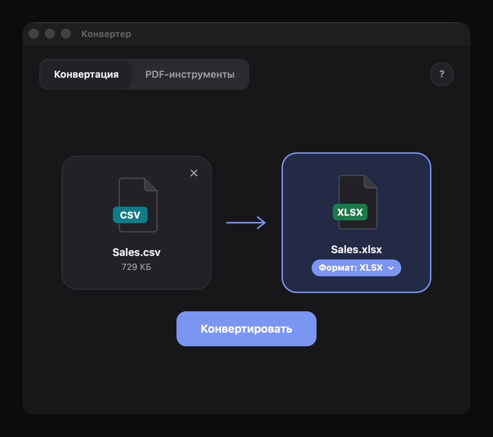
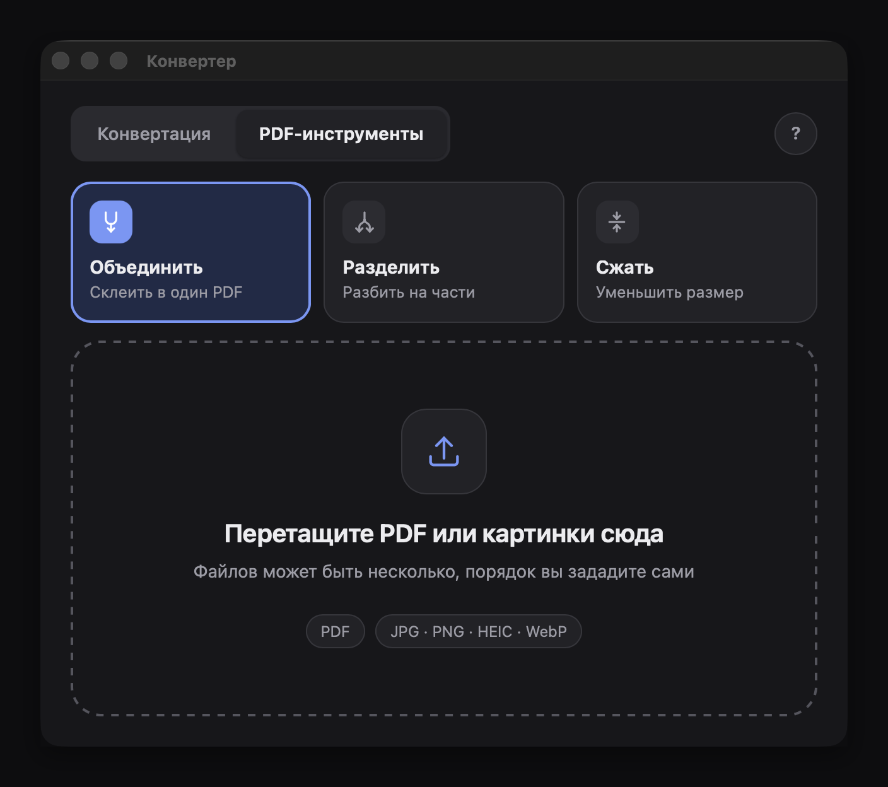

# Конвертер файлов

[](https://github.com/yungsmau/file-converter/actions/workflows/ci.yml)

Простое настольное приложение для локальной конвертации файлов. Все происходит на вашем компьютере: файлы никуда не загружаются, лимитов и подписок нет. Работает и как окно, и как программа для терминала.

<table align="center">
  <tr>
    <td></td>
    <td></td>
  </tr>
</table>

## Возможности

**Конвертация**

| Что | Во что |
|---|---|
| Таблицы: XLSX, XLSM, XLS, CSV, TSV | XLSX, CSV, TSV |
| Картинки: JPG, PNG, WebP, BMP, GIF, TIFF, HEIC (только чтение) | JPG, PNG, WebP, BMP, GIF, TIFF, PDF |
| PDF | JPG, PNG, WebP, BMP, GIF, TIFF (страница = файл), TXT |

**Инструменты для PDF:** объединить (PDF и картинки), разделить (по страницам, диапазонам или по N страниц), сжать (три уровня).

Подробности:
- CSV для русского Excel: разделитель `;`, десятичная запятая, кодировка UTF-8 с BOM. При чтении понимает UTF-8 и cp1251.
- Ведущие нули и длинные числа в CSV остаются текстом, формулы не выполняются.
- Каждый лист книги Excel сохраняется отдельным CSV-файлом.
- Существующие файлы не перезаписываются: к имени добавляется ` (1)`.
- Прозрачность при сохранении в JPEG/BMP/PDF заливается фоном, фото поворачиваются по EXIF.
- Сжатие PDF никогда не делает файл больше исходного. OCR для сканов пока нет.

## Установка

Скачайте архив для своей системы на странице [Releases](../../releases/latest) и распакуйте.

**macOS.** Приложение не подписано, поэтому при первом запуске система его заблокирует. Перетащите `Converter.app` в «Программы» и один раз выполните в терминале:

```bash
xattr -dr com.apple.quarantine /Applications/Converter.app
```

Либо откройте приложение правым кликом, пункт «Открыть», а затем «Системные настройки → Конфиденциальность и безопасность → Все равно открыть».

**Windows.** Запустите `Converter.exe` из распакованной папки. Если SmartScreen покажет предупреждение: «Подробнее → Выполнить в любом случае». Нужен Microsoft Edge WebView2 (в Windows 10 и 11 обычно уже установлен).

## Запуск из исходников

Нужен Python 3.12 или новее.

```bash
git clone https://github.com/ВАШ_ЛОГИН/file-converter.git
cd file-converter
python -m venv .venv
source .venv/bin/activate        # Windows: .venv\Scripts\activate
pip install -r requirements.txt
python app.py
```

## Командная строка

```bash
python cli.py convert таблица.xlsx таблица.csv -d ";"
python cli.py convert фото.heic фото.jpg -q 85
python cli.py convert документ.pdf страницы.png --dpi 200
python cli.py merge часть1.pdf часть2.pdf скан.jpg -o итог.pdf
python cli.py split отчет.pdf -r "1-3, 5, 11-"
python cli.py split отчет.pdf -n 10
python cli.py compress отчет.pdf -l medium
python cli.py --help
```

## Разработка

```bash
pip install -r requirements.txt -r requirements-dev.txt
pytest          # тесты
ruff check .    # проверка стиля
```

Устройство: `core/` содержит ядро без привязки к интерфейсу (читатели и писатели форматов, реестр пар «из → в», операции над PDF), `core/service.py` это слой для окна, `app.py` и `ui/` окно на pywebview, `cli.py` терминал.

Сборка приложения:

```bash
pip install pyinstaller
python -m PyInstaller --noconfirm --clean --windowed --name Converter --icon icon.icns \
  --add-data "ui:ui" --collect-submodules core --collect-all pymupdf --collect-all pillow_heif \
  --collect-all openpyxl --collect-all xlrd app.py
```

Релизы собираются автоматически: достаточно поставить тег вида `v0.2.0`.

## Лицензия

[AGPL-3.0](LICENSE). Проект использует [PyMuPDF](https://pymupdf.readthedocs.io/), который распространяется под AGPL-3.0 (или по коммерческой лицензии Artifex), поэтому и проект открыт под этой лицензией.
